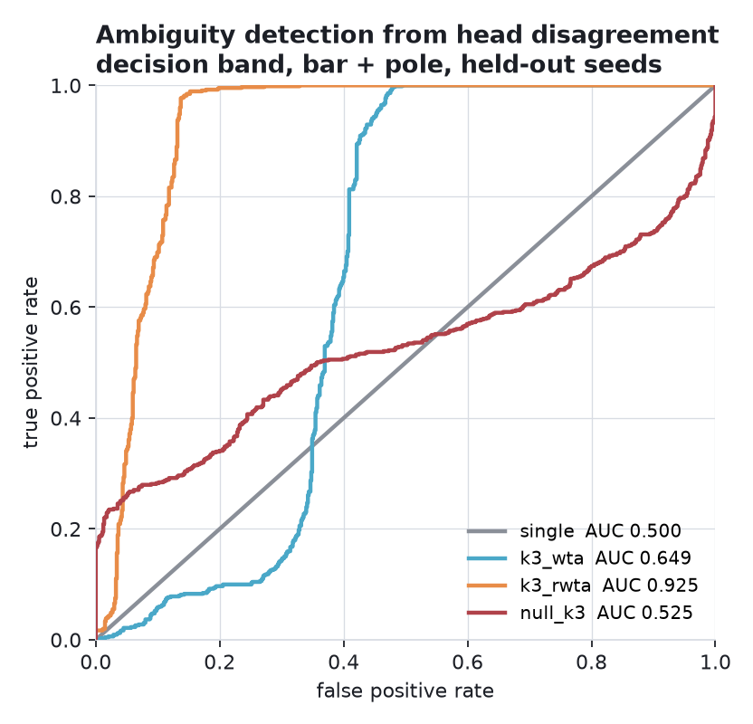
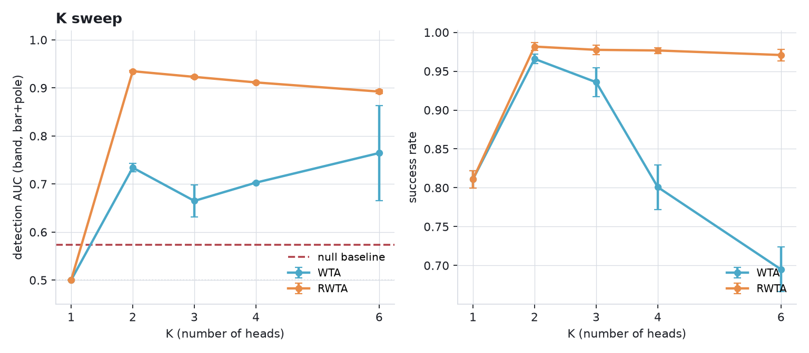
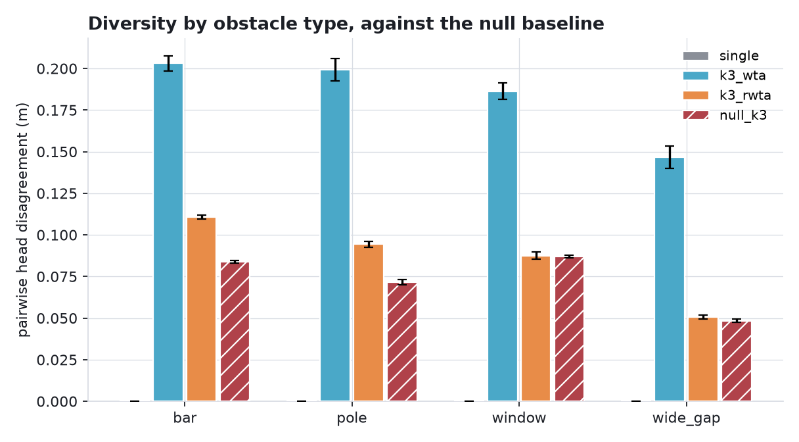

# Detecting navigational ambiguity from multi-hypothesis disagreement

A vision-based flight policy that outputs several trajectory hypotheses, where
the *disagreement between those hypotheses* is a calibrated detector of genuine
ambiguity in the scene.

At inference the policy has no map. If its hypotheses disagree, the scene is
genuinely multimodal — and this is verifiable, because the privileged teacher
*does* have the map and can compute the true number of distinct good actions at
the same state. That makes it a supervised binary problem with free labels,
scored as a detection problem on held-out seeds.

**Headline result.** Pooled over the ambiguous strata, in the planner's decision
band, disagreement detects teacher multimodality at **AUC 0.935** (K=2, RWTA,
3 training seeds) against a **null baseline of 0.525** — a model of identical
architecture trained on the same data with every second mode removed.
The pooled null is pulled down to near chance by the `pole` stratum, where
the null alone scores below chance (0.336); per-stratum AUCs with the null
beside them are in the [Ablation](#ablation) table and discussed under
[Limitations](#limitations).



---

## Scope of the contribution

**Reproduced, not invented:** privileged teacher-student training, depth as the interface, receding-horizon trajectory output, multi-hypothesis prediction with per-hypothesis cost, DAgger. This follows Loquercio et al., *Learning High-Speed Flight in the Wild* (Science Robotics, 2021), whose network already predicts three alternative trajectories with costs specifically to avoid mode averaging, and which already ablates unimodal vs. multimodal output.

**New here:**

1. Head disagreement evaluated as an ambiguity *detector*, with ground truth derived from the teacher, scored by AUC with bootstrap confidence intervals.
2. Ablation of the loss variant itself — WTA vs. relaxed WTA — which the source paper does not perform.
3. K sweep against detection performance rather than against success rate alone.
4. Diversity resolved by obstacle type, with a null baseline (see [below](#diversity-by-obstacle-type-against-the-null-baseline)).

Claiming the multi-hypothesis architecture as a contribution would be caught by any reader who knows the paper. The contribution is the measurement layer.

The results below include where the measurements contradicted the original plan.

---

## Results

All numbers below come from `results/sweep.csv`: 10 conditions × 3 training
seeds, every run under one frozen config hash (`cbb8ced787284738`), scored on
400 held-out evaluation seeds. Two intervals are reported and they are different
quantities — `±` is the half-range over training seeds, `[]` is a percentile
bootstrap over episode seeds.

### Policy ladder

| policy | success |
|---|---|
| straight line (ignores depth) | 0.270 |
| reactive depth baseline | 0.605 |
| **single regression head (K=1)** | **0.811** ±0.011 |
| student, K=2 RWTA | **0.982** ±0.005 |
| privileged teacher (ceiling) | 0.995 |

### Ablation

| condition | K | loss | success | diversity | AUC bar | AUC pole |
|---|---|---|---|---|---|---|
| single | 1 | — | 0.811 ±0.011 | 0.000 m | 0.500 | 0.500 |
| k2_wta | 2 | WTA | 0.966 ±0.006 | 0.141 m | 0.758 ±0.042 | 0.710 ±0.026 |
| **k2_rwta** | 2 | RWTA | **0.982** ±0.005 | 0.089 m | **0.900** ±0.007 | **0.969** ±0.003 |
| k3_wta | 3 | WTA | 0.936 ±0.019 | 0.184 m | 0.649 ±0.074 | 0.680 ±0.053 |
| k3_rwta | 3 | RWTA | 0.978 ±0.006 | 0.086 m | 0.881 ±0.005 | 0.965 ±0.001 |
| k4_wta | 4 | WTA | 0.801 ±0.029 | 0.291 m | 0.724 ±0.011 | 0.681 ±0.010 |
| k4_rwta | 4 | RWTA | 0.977 ±0.004 | 0.081 m | 0.863 ±0.003 | 0.959 ±0.001 |
| k6_wta | 6 | WTA | 0.695 ±0.029 | 0.353 m | 0.790 ±0.039 | 0.739 ±0.159 |
| k6_rwta | 6 | RWTA | 0.971 ±0.008 | 0.075 m | 0.834 ±0.006 | 0.950 ±0.002 |
| **null baseline** | 3 | RWTA | 0.979 ±0.004 | 0.073 m | **0.810** ±0.077 | **0.336** ±0.072 |

The single head is not a straw man: it flies at 0.811, and its deficit is
concentrated exactly where the theory predicts mode averaging — `pole` 0.640
against K=3's 0.920 — while the unimodal control strata do not move at all
(`window` 0.960 → 0.960, `wide_gap` 1.000 → 1.000).

### K is measured, and the answer is 2



| K | 1 | 2 | 3 | 4 | 6 |
|---|---|---|---|---|---|
| RWTA detection AUC | 0.500 | **0.935** | 0.923 | 0.911 | 0.892 |
| RWTA success | 0.811 | **0.982** | 0.978 | 0.977 | 0.971 |

Detection AUC peaks at K=2 and declines monotonically. This world has exactly
two modes wherever it has any — over/under, left/right — and the sweep recovers
that number without being told it. The source paper's K=3 is one head more than
this task can use.

### WTA collapses as K grows; RWTA does not

Under WTA, success falls 0.966 → 0.936 → 0.801 → 0.695 across K = 2, 3, 4, 6
while **diversity rises** 0.141 → 0.353 m. More heads means more heads that
never win, each parked outside the label distribution, inflating the diversity
metric while degrading the policy. RWTA holds success flat at 0.971–0.982 across
the same range.

This is why two diagnostics are logged and not one. A dead head produces *high*
diversity: in a deliberately broken run it read **5.67 m**, the largest number
in any run in this project, while its win rate sat at exactly 0.00.

### Diversity by obstacle type, against the null baseline



| | bar | pole | window | wide_gap |
|---|---|---|---|---|
| K=3 RWTA | 0.111 | 0.094 | 0.087 | 0.050 |
| null baseline | 0.084 | 0.071 | 0.087 | 0.048 |
| **increment** | **+0.027** | **+0.023** | **+0.000** | **+0.002** |

On the control strata the null and the trained model have *identical*
diversity — as they must, since there is no second mode to represent. On the
ambiguous strata the trained model carries a consistent increment. Quoting the
raw ratio alone (1.48×) would overstate this roughly threefold: three quarters
of the raw diversity on `bar` exists without any multimodality supervision.

### Video

`results/disagreement.mp4` — chase view with the K predicted trajectories drawn,
the 64×48 depth input, and the live disagreement trace. At the decision range,
one representative frame per stratum reads:

| bar | pole | window | wide_gap |
|---|---|---|---|
| **1.354 m** | 0.331 m | 0.119 m | 0.041 m |

---

## What did not work

Two results here are negative, and both are reported because they were measured
rather than assumed.

### The original demo claim is false

The original project plan promised: *"the agent slows at a bar, stays fast through a window."*
Measured over 800 held-out seeds, mean speed inside the decision band:

| bar | pole | window | wide_gap |
|---|---|---|---|
| 4.526 [4.521, 4.532] | 4.518 | 4.521 | 4.519 [4.515, 4.523] |

The difference between ambiguous and control strata is **+0.002 m/s**, and the
bar is if anything marginally *faster*. **The claim is withdrawn.**

The mechanism is clear in hindsight: nothing connects disagreement to the
throttle. The student imitates trajectories from a teacher that plans at a fixed
speed, and disagreement is a quantity *read out* of the heads, never fed back
into control. Closing that loop is a natural extension and is not part of this
work. It would have been easy to render a video that looked like the claim was
true, which is precisely why it was measured before it was rendered.

### DAgger contributes nothing here

Rounds 2–4 were run as specified — the student flies, the teacher labels, the
dataset accumulates, retrained from scratch, no perturbation injected. Three
independent measurements agree that it adds nothing on this task:

1. **The state distribution does not shift.** Across four rounds, mean speed,
   goal-bearing offset and the teacher's own cost are unchanged — including the
   tails: cost p90 and p99 are flat to three decimals.
2. **The flight gain was data volume.** Rounds 2–4 change two things at once, so
   the control was the *teacher* flying the same 6,000 extra seeds at matched
   volume: **0.983 vs DAgger's 0.980.** Indistinguishable.
3. **Recovery agrees.** Against its matched control, DAgger is +0.028 at 1.0 m
   displacement and **−0.038 at 2.0 m** — the sign flips.

The student *does* recover from states the teacher never visits (0.62–0.86
against a 0.40–0.57 reactive floor, teacher ceiling 0.72–0.91). It simply does
not need DAgger to do so, plausibly because the labels were computed at every
state the teacher passed through rather than along one committed trajectory.

---

## Limitations

- **The ground truth is a definition, not an oracle.** `n_modes` is the teacher's
  cluster count under a chosen threshold τ and cost margin. The *separation*
  survives τ across 2.6× and the margin across 6× — with the control strata
  pinned at 0.00 throughout — but every AUC in this repository is an AUC against
  that construct.
- **`bar` clears the null by only 0.071** (0.881 vs 0.810). 92% of the
  bar-stratum AUC is reproduced by a model that never saw a second mode. The
  pooled figure is clean (0.935 vs 0.525) because the null scores *below* chance
  on `pole` (0.336) — its head spread has a preferred direction, an
  initialisation artefact rather than weak ambiguity detection. The bar number
  should never be quoted without the null beside it.
- **`window` and `wide_gap` cannot be scored as detection rows** — 2–8 and 0
  in-band positives. They are the negative class, not detection results.
- **The all-states AUC of 0.997 is not a result.** 98.8% of states are far from
  any obstacle where the answer is trivially "unimodal"; that number largely
  measures whether the drone is near something. Detection is reported inside a
  1.5 m band derived from the planner horizon.
- **The custom simulator** is a deliberate choice (fast, batched, and with a
  teacher that can read the map), not a hidden
  limitation. No number here is compared to the source paper's.
- **One task, four obstacle types, one corridor geometry.** "K=2" means K=2 *for
  a world whose modes come in pairs*.

---

## Reproduce

```bash
# Python >= 3.11 (numpy 2.5 requires it); tested on 3.12
python -m venv .venv && . .venv/bin/activate
pip install -r requirements.txt

pytest                                                   # 144 tests, ~2 min
python -m eval.audit  --split eval --n 400               # week-2 multimodality gate
python -m train.collect --seeds 2400 --out data/round1.pt        # ~30 s
python -m train.dagger  --rounds 4                               # ~8 min
python -m train.sweep                                            # ~55 min, 30 runs
python -m eval.ablate                                    # tables + plots
python -m eval.detect --ckpt runs/sweep/k2_rwta_s0/model.pt
python -m eval.recover --ckpt runs/sweep/k2_rwta_s0/model.pt
python -m eval.demo_claim --ckpt runs/sweep/k2_rwta_s0/model.pt
```

Single RTX 3090. Simulator runs at 50,714 env-steps/s; the teacher labels at
45,934 states/s. Training is bitwise reproducible from a seed.

## Layout

| | |
|---|---|
| `sim/` | simulator, teacher, clustering — no learned component |
| `train/` | student, losses, diagnostics, DAgger, sweep |
| `eval/` | harness, detection AUC, recovery, ablation, plots, video |
| `derisk.md` | the mid-project check that set week 4's gate |
